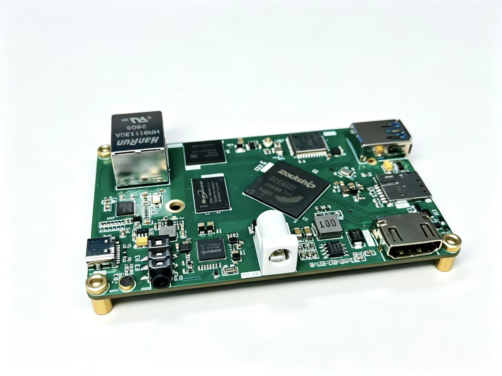

# RK3568B2 Board V10 — Debian 12 桌面镜像



> 自制 RK3568B2 开发板的完整可烧录固件。Debian 12.15 + XFCE 桌面，
> 开箱自动登录，GPU 硬件加速、HDMI 1080p60、千兆以太网、NPU、USB、
> 3.5mm 耳机 + MIC 全部验证通过。

## 固件

| 文件 | 大小 | MD5 |
|---|---|---|
| `update.img.zst` | 968 MB | `7a417284e5c70ade70a96da08f7c5d85` |

解压后为 4.41 GB 的 `update.img`。

### Linux / macOS

```bash
# Debian/Ubuntu
sudo apt install zstd
zstd -d update.img.zst

# macOS
brew install zstd
zstd -d update.img.zst
```

### Windows

`.zst` **不能双击解压**，需要先装工具：

1. 下载 **7-Zip**（免费）：<https://www.7-zip.org/>
   - 需要 **21.07 或更新版本**（旧版不支持 zstd）
   - 或 **Bandizip 7.0+**（界面更友好）
2. 装好后**右键** `update.img.zst` → `7-Zip` → `提取到当前文件夹`
3. 得到一个 4.41 GB 的 `update.img`

> ⚠️ **WinRAR 和 Windows 自带的解压都不支持 `.zst`**，别用这两个。

## 镜像里有什么

| 组件 | 版本 / 说明 |
|---|---|
| 系统 | **Debian 12.15 (bookworm) + XFCE** |
| 内核 | Linux 6.1.141 + 板级设备树 `rk3568-board-v10.dts` |
| u-boot | 板级设备树 `rk3568-board.dts`（串口显示 `RK3568B2 Board V10`）|
| 登录 | 用户名 `linaro`，密码 `linaro`，**lightdm 自动登录** |
| apt 源 | 阿里云（已配好）|
| 时区 | UTC（已启用 chrony 自动对时）|

### 已验证的功能

| 功能 | 状态 | 说明 |
|---|---|---|
| 启动 | ✅ | eMMC 64GB，HS200 200MHz |
| 桌面 | ✅ | XFCE，自动登录 |
| GPU | ✅ | Mali-G52，`glmark2-es2-drm` @1080p **Score 102** |
| HDMI | ✅ | 1080p60，热插拔正常 |
| 以太网 | ✅ | RTL8211F **1Gbps 全双工** |
| 3.5mm 耳机 | ✅ | RK809 codec，插拔检测 + 自动切换 |
| MIC 录音 | ✅ | PipeWire 录音源 |
| NPU | ✅ | rknpu 0.9.8，900MHz |
| USB | ✅ | hub + 千兆网卡 + 键鼠，**无需外接电源** |
| WiFi 驱动 | ✅ | 已改用 SDIO 带内中断，加载正常 |
| **WiFi 收发** | ⚠️ | **能发不能收**，见下方已知问题 |
| M.2 NVMe | ⏳ | 未实测 |

## 烧录方法

### 方式一：Linux + upgrade_tool

```bash
UT=<SDK>/tools/linux/Linux_Upgrade_Tool/Linux_Upgrade_Tool/upgrade_tool

# 板子按住 MASKROM 键上电，进入 MaskROM
$UT ld                 # 必须显示 Mode=Maskrom
$UT uf update.img      # 整包烧写，约 15~20 分钟
$UT rd
```

> 如果 `ld` 报 `connected(0)`：检查 USB 线、换 USB 2.0 口、不要经过 hub。
> 如果 `uf` 报 `Download boot failed / check ddr`：**彻底断电**（拔电源等 10 秒）
> 再按住 MASKROM 上电。
> 建议先 `sudo systemctl stop ModemManager`，它会抢 USB 设备。

### 方式二：Windows + RKDevTool

> 先用 7-Zip 把 `update.img.zst` 解压成 `update.img`（见上方「Windows」一节）。

1. 安装 Rockchip USB 驱动（DriverAssistant）
2. 打开 `RKDevTool.exe`，应显示「发现一个 MASKROM 设备」
3. 点「升级固件」→ 选 `update.img` → 「升级」

## 板级文件

设备树、u-boot、构建脚本都在主仓库，可以按需修改后重新编译：

```bash
git clone <主仓库地址>
cd board-port
./apply-to-sdk.sh /path/to/sdk
cd /path/to/sdk && ./build.sh kernel && ./build.sh firmware
```

## 已知问题

### WiFi 能发不能收

- **发射正常**：adhoc 模式下手机能看到板子的 SSID
- **接收灵敏度极低**：只能收到近在咫尺的强信号，周围 AP 全部扫不到
- 天线、PCB 走线、供电、时钟、监管域、驱动、固件、系统**均已排除**
- 进一步定位需要频谱分析仪

**替代方案**：用 USB WiFi 网卡（RTL8188/8192，内核驱动已内置）。

### 其他

- M.2 NVMe 未实测
- MAC 地址随机生成（正式产品应从 OTP 读取）
- HDMI 音频优先级（3000）高于 RK809（1000），默认输出会被 HDMI 抢走，
  需要时用 `pactl set-default-sink <rk809 的 sink id>` 切换

## 硬件说明

这是一块**自制板**，首板调试过程中发现并解决了 9 个硬件问题中的 8 个，
包括元件漏贴、虚焊、供电余量不足等。**打算复刻的话，强烈建议先看主仓库的
`docs/hardware.md` 第 7、8 节**——里面写了每个问题的现象和定位方法。

原理图 / PCB / BOM 见立创开源硬件平台（OSHWHub）工程页。
